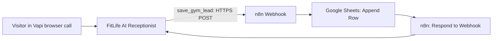

# FitLife AI Receptionist — Gym Membership Voice Automation

An AI-powered gym receptionist prototype that answers membership questions, captures consented inquiries, and sends structured leads into a Google Sheets CRM through an n8n webhook.

**Author:** Rabia Batool  
**Project type:** Personal portfolio · AI voice automation prototype  
**Demo business:** FitLife Gym (fictional)  
**Technology:** Vapi · n8n · Google Sheets · HTTPS webhooks

## Overview

FitLife AI Receptionist demonstrates a voice-assisted lead capture workflow. In a Vapi browser call, the assistant discusses gym membership options and facilities, asks permission to collect contact details, confirms the information, and uses an API request tool to send it to an n8n workflow. n8n adds the data to a Google Sheets lead tracker and returns a JSON response.

This is a **browser-call demonstration**, not a deployed public telephone or Twilio line. Gym pricing, business details, and lead records are fictional.

## Features

- Conversational responses to gym membership, opening-hour, and facility questions.
- Sample membership tiers: **Basic ($25/month), Standard ($40/month), Premium ($60/month)**. All prices are fictional.
- Permission-based capture of name, phone, optional email, membership plan, and inquiry type.
- `save_gym_lead` Vapi API Request tool sending HTTPS `POST` data to n8n.
- n8n Google Sheets integration for timestamped lead records and initial `New Lead` status.
- Header-based API authentication configured for the webhook, with credentials kept out of the repository.
- JSON webhook response after the sheet-writing step.

## Architecture



## Technology stack

| Component | Technology | Purpose |
| --- | --- | --- |
| Voice assistant | Vapi | Real-time conversational interface |
| AI response generation | OpenAI model configured in Vapi | Answer gym questions and collect lead details |
| Workflow automation | n8n Cloud | Webhook handling and CRM update |
| Lead storage | Google Sheets | Demonstration lead tracker |
| Integration | HTTPS POST / JSON | Communication between Vapi and n8n |

## How it works

1. A visitor starts a test call with **FitLife AI Receptionist** in Vapi.
2. The assistant explains the fictional gym's services and membership options.
3. With the visitor's permission, it collects and confirms the information needed for follow-up.
4. The `save_gym_lead` tool submits the inquiry fields to the configured n8n production webhook.
5. n8n processes the request using **Webhook → Google Sheets (Append Row) → Respond to Webhook**.
6. A lead row appears in the `Gym_Leads` worksheet and the webhook returns a JSON response.

## Lead-tracker schema

| Column | Description |
| --- | --- |
| Timestamp | Date and time recorded |
| Full Name | Caller-provided name |
| Phone | Phone string; store as plain text to preserve leading zeroes |
| Email | Optional contact email |
| Membership Plan | Basic / Standard / Premium |
| Inquiry Type | Membership Inquiry / Gym Tour / Callback |
| Lead Status | Initially `New Lead` |
| Source | Voice-agent or test source label |

## Reproducing the prototype

1. Create your own Vapi assistant with a fictional gym description, membership options, and instructions to request permission before saving leads.
2. Create a Google Sheet with the columns above.
3. In n8n, build a workflow with a **POST Webhook**, **Google Sheets — Append Row**, and **Respond to Webhook**.
4. Configure webhook authentication using a newly generated private secret and a matching Vapi credential. Never commit the secret to GitHub.
5. In Vapi, configure an API Request tool named `save_gym_lead` with body properties `name`, `phone`, `email`, `membership_plan`, and `inquiry_type`; set the URL to your own n8n production webhook.
6. Attach the tool to the assistant and publish the current configurations.
7. Test with fictional, consented contact information and confirm a successful n8n execution and new sheet row.

If included, see [`docs/setup-guide.md`](docs/setup-guide.md) for additional implementation notes and [`docs/test-checklist.md`](docs/test-checklist.md) for verification steps.

## Testing and evidence

The following were observed during development:

- Vapi assistant interacted with a test caller through its **browser call** interface.
- A fictional lead submitted to the n8n webhook appeared in Google Sheets.
- n8n displayed successful executions of the three-node lead-capture workflow.
- The Vapi `save_gym_lead` tool was configured and published with a credential selection.

**Verification boundary:** Successful n8n executions do not by themselves prove that every voice call invoked the authenticated tool. An authenticated end-to-end call should be rechecked using matching Vapi call logs, n8n execution details, and the resulting sheet row. Do not present a public inbound phone deployment as tested.

### Screenshots

Add only redacted screenshots that you are comfortable sharing publicly. Suggested evidence:

- Vapi assistant configuration and browser-call transcript
- `save_gym_lead` tool configuration, with endpoint details and credentials hidden
- n8n workflow canvas and successful execution
- Google Sheets demo lead row with fictional contact details

Screenshots can be stored in [`screenshots/`](screenshots/). No personal voice recordings or publicly accessible demo videos are required for this portfolio repository.

## Limitations

- Browser-based Vapi calls were tested; **no public telephone number or Twilio inbound deployment** is claimed.
- Google Sheets is a demonstration CRM, not a hardened multi-user customer system.
- The prototype does not guarantee exactly-once lead creation. Deduplication, payload validation, rate limiting, and error alerts would be useful production upgrades.
- n8n Cloud trial availability and Vapi usage credits may affect future operation.
- The webhook authentication configuration and final published workflow should be verified together before a production claim.
- Personal information should not be collected without appropriate notice, consent, and retention rules.

## Repository structure

```text
fitlife-ai-receptionist/
├── README.md
├── .env.example
├── .gitignore
├── docs/
│   ├── setup-guide.md
│   ├── test-checklist.md
│   └── crm-columns.csv
├── workflows/
│   ├── README.md
│   └── [sanitized n8n and Vapi JSON exports, if included]
└── screenshots/
    └── [redacted demo screenshots, if included]
```

Do not upload the original private `.env`, real access keys, Vapi/n8n credentials, unredacted account data, real lead records, or private call recordings. Review exported workflow JSON for live endpoints and credential references before making the repository public.

## Scope

This project illustrates how conversational AI and no-code automation can reduce manual lead entry for a fictional gym. It is a **portfolio prototype**, not a production-ready call center or customer data platform.
